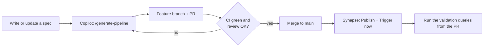

# Contributing

## Team workflow

1. **Branch:** `feat/<use_case>-<short-desc>` or `fix/<use_case>-<short-desc>`. Nobody pushes to `main`, because it's protected.
2. **Spec first.** Agree the spec with the data owner before generating code. Specs are reviewed like code.
3. **Generate:** Copilot Chat → Agent mode → `/generate-pipeline`. Read the plan Copilot shows before you approve it.
4. **Review:** run `/review-pipeline`, then do a human review. At least one approval from CODEOWNERS is required.
5. **Merge, Publish, Run:** follow the steps in the PR description.

## Changing the rules (platform owners)
| You want to… | Edit |
|---|---|
| Change a rule every generation must follow | `.github/copilot-instructions.md` |
| Change rules for one file type | `.github/instructions/<area>.instructions.md` (`applyTo` glob) |
| Teach a new pattern, or fix a recurring mistake | The relevant `.github/skills/<skill>/SKILL.md` and its `references/` |
| Add a new reusable chat command | A new `.github/prompts/<name>.prompt.md` |
| Support a new activity or artifact type | `tools/build_synapse.py`, plus a note in the synapse-pipeline skill |

When Copilot makes the same mistake twice, fix the **skill or instructions**, not just the code. That way the fix applies to everyone.

## Commit messages
Use Conventional Commits: `feat(silver): …`, `fix(gold): …`, `docs: …`, `chore(tools): …`.
