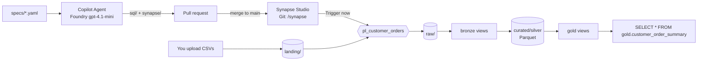

# Spec-driven Synapse pipelines with GitHub Copilot + Azure AI Foundry

Write a YAML spec and ask Copilot to generate the pipeline. Review the PR, merge it, click **Trigger now** in Synapse, and query the result.

GitHub Copilot (Agent mode, running on **your own model in Azure AI Foundry**) reads the specs and the rules in this repo. It generates Azure Synapse **serverless SQL** and a Synapse **pipeline**, then opens a pull request. Synapse Studio picks the code up from Git. The pipeline moves the data from `landing` to `raw` to `curated` (bronze, silver, gold).



## Quickstart (for an environment that's already set up)
1. Open this folder in VS Code. In Copilot Chat, choose **Agent** mode and your Foundry model.
2. Type `/generate-pipeline` and press Enter. Review the plan and the staged files, then let it open the PR.
3. Merge the PR once CI is green.
4. Upload `data/sample/customers.csv` and `orders.csv` to the **landing** container.
5. In Synapse Studio: branch **main** → **Publish** → **Integrate** → `pl_customer_orders` → **Trigger now**.
6. Query it: `SELECT * FROM demo_lakehouse.gold.customer_order_summary;` on the **Built-in** pool.

For a first-time setup, follow [docs/setup](docs/setup/) in order.

## Repo map
| Path | What | Who edits |
|---|---|---|
| `specs/sources/`, `specs/models/` | Source and model contracts | Humans, with Copilot drafting through `/add-new-source` |
| `config/environment.yaml` | Account, container and workspace names (no secrets) | Humans |
| `sql/` | Generated T-SQL (setup, bronze, silver, gold) | Copilot |
| `synapse/` | Generated Synapse Git artifacts (pipeline, linked services, datasets) | `tools/build_synapse.py` only |
| `tools/build_synapse.py` | Validates the specs and SQL, and builds `synapse/` | Platform owners |
| `.github/copilot-instructions.md` | Repo-wide rules Copilot always follows | Platform owners |
| `.github/instructions/` | Path-specific rules (`applyTo` globs) | Platform owners |
| `.github/skills/` | Detailed how-to playbooks and reference SQL | Platform owners |
| `.github/prompts/` | `/generate-pipeline`, `/add-new-source`, `/review-pipeline` | Platform owners |
| `.github/agents/` | The `data-engineer` custom agent | Platform owners |
| `data/sample/` | Sample CSVs to upload to `landing/` | Humans |
| `docs/` | Architecture, setup and onboarding | Everyone |

## Commands
```bash
./tools/build.sh validate   # check specs + SQL rules (creates .venv on first run)
./tools/build.sh build      # regenerate synapse/ from sql/
./tools/build.sh check      # CI check: synapse/ is in sync
```

## Cost (demo scale)
Serverless SQL is about $5 per TB scanned, so KB-sized files cost effectively $0. Each pipeline run is about $0.02 (copy plus orchestration). The Foundry model costs cents per session. There are **no Spark or Dedicated SQL pools**.
