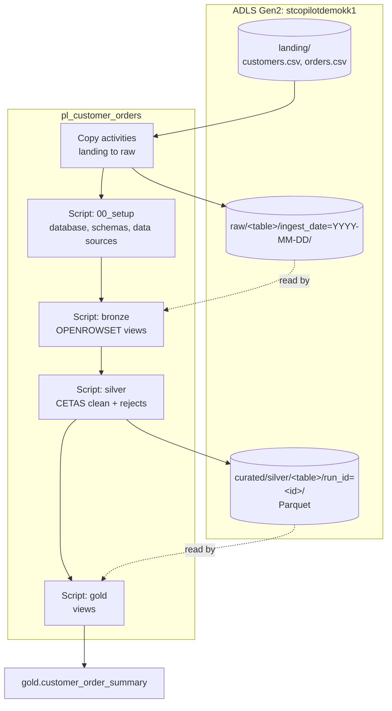
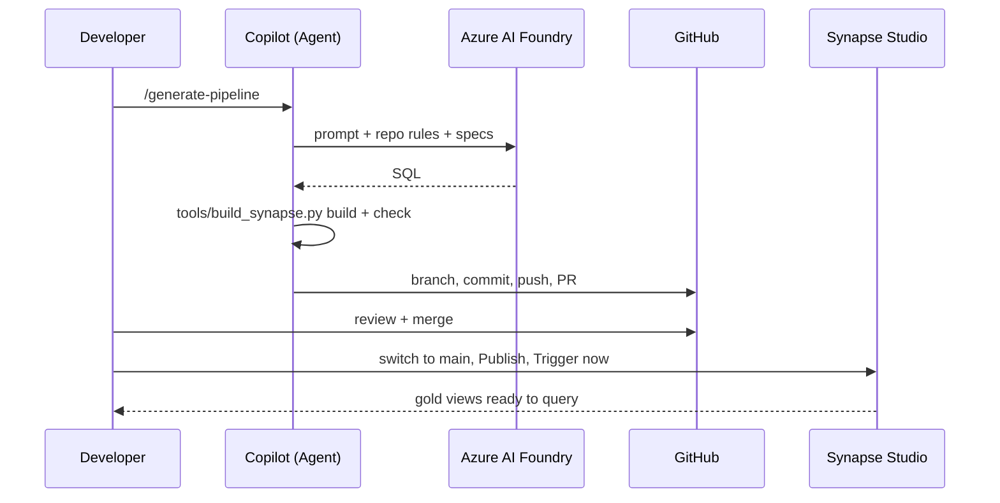

# Architecture

## Components
| Component | Name | Notes |
|---|---|---|
| Code generation | GitHub Copilot Chat (VS Code, Agent mode) | Uses the repo rules, skills and prompts |
| Model | Azure AI Foundry: project `kyenugutala-9617`, deployment `gpt-4.1-mini-1` | Bring your own model. Billed to Azure, not to Copilot premium requests. |
| Source control | GitHub repo, `main` protected | CI: `tools/build_synapse.py validate` + `check` |
| Storage | ADLS Gen2 `stcopilotdemokk1` | Containers `landing`, `raw`, `curated` |
| Compute | Synapse workspace (Serverless SQL "Built-in" only) | No Spark or Dedicated pools |
| Orchestration | Synapse pipeline `pl_customer_orders` | Copy and Script activities, run manually with *Trigger now* |

## Data flow

## Layers
| Layer | Object type | Data stored? | Rebuilt on each run |
|---|---|---|---|
| landing | Files you upload | Yes | No (you manage it) |
| raw | CSV copies by ingest date | Yes (history) | Same-day files are overwritten |
| bronze | Views over raw | No | `CREATE OR ALTER VIEW` |
| silver | External tables (Parquet) + rejects | Yes, a new `run_id` folder per run | Drop the external table, then CETAS |
| gold | Views over silver | No | `CREATE OR ALTER VIEW` |

## Security
- No secrets in code. Linked services and SQL use the **workspace managed identity**. Interactive queries use **your Entra ID identity**.
- Both identities need **Storage Blob Data Contributor** on the storage account.
- The Foundry API key is stored only in VS Code's secret storage on each developer's machine.

## Code generation flow

